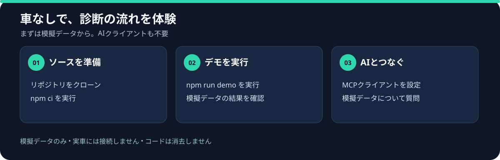

# obd2-mcp

**[実際の出力を見る・AIクライアントなしでデモを実行する](./docs/demo-results.md)**



**車もAIクライアントも不要：** リポジトリをクローンし、`npm ci` のあとに `npm run demo` を実行します。[詳しい手順と出力例を見る](./docs/demo-results.md)。

npmパッケージの公開と所有者の確認が済んだ後は、`npx -y obd2-mcp@0.2.0 --demo` でもデモを実行できます。

**初めての方へ：[車なしで試せるモック体験ガイド](./docs/try-mock.md#日本語)**

[English](./README.md) | **日本語**

[](./LICENSE)

安価なELM327アダプタ経由で、AIアシスタントが**あなたの車のOBD-IIデータを直接読める**ようにするMCPサーバーです。故障コード(DTC)、ライブセンサー、フリーズフレーム、レディネスモニタ、車台番号(VIN)に対応。

Claudeに「エンジン警告灯が点いたのはなぜ?」と聞くと、**実車から実際のコードを読み取り**、消える前にフリーズフレームを確保し、燃料補正を確認して原因を推論します — スキャナーの画面を手で書き写す必要はもうありません。

**アダプタがなくても動きます。** 内蔵のモック車両(暖機済みアイドリング中のセダン、P0420記録済み、警告灯点灯、リアルなライブデータ)で、アダプタを買う前にすべて試せます。

## クイックスタート(モックモード — ハードウェア不要)

GitとNode.js/npmを用意し、ソースからビルドします。npm経由で導入する場合は、先にパッケージの公開状況を確認してください。

```bash
git clone https://github.com/shoka-jp/obd2-mcp.git
cd obd2-mcp
npm ci
npm run build
node -p "require('node:path').resolve('dist/index.js')"
```

以下の `/absolute/path/to/obd2-mcp/dist/index.js` は最後のコマンドで表示された実際の絶対パスに置き換えてください。WindowsのJSON設定では区切り文字に `/` を使用できます。

**Claude Code:**

```bash
claude mcp add obd2 -- node "/absolute/path/to/obd2-mcp/dist/index.js"
```

**Claude Desktop**(`claude_desktop_config.json`):

```json
{
  "mcpServers": {
    "obd2": {
      "command": "node",
      "args": ["/absolute/path/to/obd2-mcp/dist/index.js"]
    }
  }
}
```

そして聞いてみてください:「車の故障コードを読んで、お金を使う前に確認すべきことを教えて」

### 別のモックシナリオを試す

MCPクライアントの設定で `OBD2MCP_CONNECTION=mock` と合わせて `OBD2MCP_MOCK_SCENARIO` を指定できます。`catalyst`（既定、P0420）、`healthy`（コードなし）、`misfire`（P0301）、`lean`（P0171と高めのバンク1燃料補正）から選べます。いずれも学習用の模擬データで、実車の故障診断や車両プロファイルを保証するものではありません。未対応のシナリオ名では起動を停止します。実車接続時にはこの設定を使用しません。

たとえばClaude Codeに別のモックサーバーを登録します。

```bash
claude mcp add obd2-lean --env OBD2MCP_CONNECTION=mock --env OBD2MCP_MOCK_SCENARIO=lean -- node "/absolute/path/to/obd2-mcp/dist/index.js"
```

設定変更後はサーバーを再起動してください。モックの状態はサーバーごとに独立しています。モックの消去はレディネスをリセットしますが、実車には影響しません。

## 実車への接続

ELM327互換アダプタ(USB / Bluetooth / WiFi、1,000〜3,000円程度)をOBD-IIポートに挿します(日本車はおおむね2008年以降のOBD2義務化車両で確実、それ以前も多くが対応。イグニッションON)。

接続先は環境変数またはCLIフラグで指定:

| アダプタ | 設定 |
|---|---|
| USB / Bluetooth(シリアル) | `OBD2MCP_CONNECTION=serial:COM3`(Windows)/ `serial:/dev/ttyUSB0`(Linux)/ `serial:/dev/tty.usbserial-XXXX`(macOS) |
| WiFi | `OBD2MCP_CONNECTION=tcp:192.168.0.10:35000` |
| モック(デフォルト) | `OBD2MCP_CONNECTION=mock` |

シリアルのボーレートは既定38400。必要なら`OBD2MCP_BAUD=115200`で変更。BluetoothアダプタはOS側でペアリングしてシリアルポートとして見える状態にしてください。

実車接続でのClaude Code登録例:

```bash
claude mcp add obd2 --env OBD2MCP_CONNECTION=serial:COM3 -- node "/absolute/path/to/obd2-mcp/dist/index.js"
```

## ツール一覧

| ツール | 内容 |
|---|---|
| `read_dtcs` | 記録済み+ペンディングの故障コード、警告灯の状態、コード数 |
| `read_freeze_frame` | フリーズフレームを記録させたDTCと、その瞬間のエンジン状態 |
| `read_live_data` | ライブセンサー:回転数、水温、燃料補正、MAF、O2電圧など(22 PID) |
| `read_readiness` | レディネスモニタの完了状態(検査に通る状態かの判定材料) |
| `read_vin` | ECUから車台番号を読み取り |
| `connection_status` | アダプタの識別情報とポートのバッテリー電圧 |
| `clear_dtcs` | コード消去 — **実車では初期状態で無効**。フリーズフレームが消え、モニタがリセットされます |

## automotive-ai-skills との連携 🔧

このサーバーは「道具」レイヤーです。「知識」レイヤー — コードから原因への推論方法、部品を買う前に試すべきテスト、プロに任せる境界 — は [automotive-ai-skills](https://github.com/shoka-jp/automotive-ai-skills) が担います:

```text
/plugin marketplace add shoka-jp/automotive-ai-skills
/plugin install automotive-ai-skills@automotive-ai-skills
claude mcp add obd2 -- node "/absolute/path/to/obd2-mcp/dist/index.js"
```

両方入れると、Claudeが実車からコードを読み、**その上で診断ワークフローを回します**。

## 安全設計とスコープ

- **実車のコード消去は初期状態で無効です。** モード04を使うには、サーバー起動前に `OBD2MCP_ENABLE_CLEAR=1` を設定し、`confirm` 引数を true にしたうえで、別途表示されるMCP確認フォームで承認してください。フォーム確認に非対応のクライアントでは実車の消去はできません。確認が人に提示されることはクライアントに依存し、サーバー側では承認者の本人確認はできません。モックでは消去をテストできます。
- **応答の制限。** 複数ECUの応答や未対応の圧縮着火エンジンのレディネスは、推測せずエラーを返します。アダプターのタイムアウトや切断後はサーバーを再起動してください。実車とアダプターでの互換性は別途確認が必要です。
- **診断の支援であって、判決ではありません。** コードは「失敗したテスト」を示すもので「壊れた部品」ではありません。お金を使う前に物理テストで確定させ、安全系(ブレーキ、燃料、SRS、高電圧)はプロに任せてください。
- 運転しながらAIとやり取りしないでください。読み取りは停車中に。

## 開発

```bash
git clone https://github.com/shoka-jp/obd2-mcp.git
cd obd2-mcp
npm install
npm test        # ビルド+モック車両に対するstdioスモークテスト
npm run test:package  # 配布用tarballを別環境へインストールして検証
```

モック車両はELM327プロトコルレベルで応答するため、テストはパース系全体(マルチフレームのVIN応答含む)を通ります。

## プロジェクトを応援する

役立った方は、次の方法で開発を応援していただけます。

- [開発者をフォロー](https://github.com/shoka-jp)して、自動車 × AIの開発をチェックする。
- リポジトリをStarして保存したり、必要としている人に紹介する。
- [Issue](https://github.com/shoka-jp/obd2-mcp/issues)で、試した手順・期待した結果・実際の結果を共有する。ログから車台番号などの個人情報を取り除いてください。
- [GitHub Sponsors](https://github.com/sponsors/shoka-jp)でオープンソース活動を支援する。

## ライセンス

[MIT](./LICENSE) © 2026 Sho Kamakura
