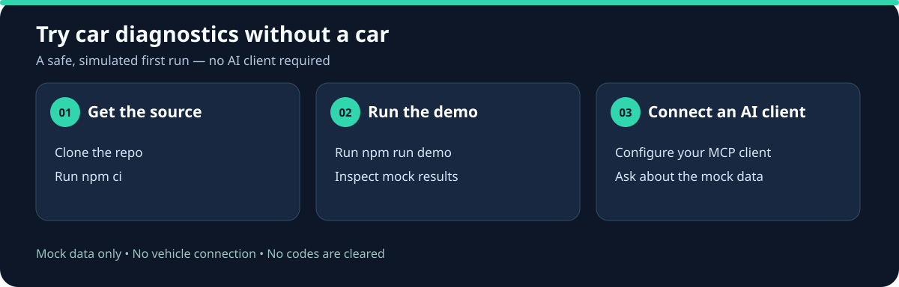

# obd2-mcp

**[See actual mock output and run the demo without an AI client](./docs/demo-results.md).**

**New here? [Try the step-by-step mock demo — no car required](./docs/try-mock.md).**

**English** | [日本語](./README.ja.md)

[](./LICENSE)

An MCP server that lets AI assistants read your car's OBD-II data through cheap ELM327 adapters — trouble codes, live sensors, freeze frame, readiness monitors, and VIN.



**Try it without an AI client or car:** clone the repository, run `npm ci`, then `npm run demo`. [See the full steps and sample output](./docs/demo-results.md).

After the npm package is published and its ownership verified, the concise demo can also be run with `npx -y obd2-mcp@0.2.0 --demo --summary`.

Ask Claude *"why is my check-engine light on?"* and it reads the actual codes from your actual car, pulls the freeze frame before anything gets erased, checks the fuel trims, and reasons about causes — instead of you transcribing scanner output by hand.

**No hardware? It still works.** A built-in mock vehicle (a warm idling sedan with a stored P0420, MIL on, and realistic live data) lets you try everything before buying an adapter.

## Quick start (mock mode — no hardware)

Build from source using Git and Node.js/npm. Verify npm availability before using registry installation.

```bash
git clone https://github.com/shoka-jp/obd2-mcp.git
cd obd2-mcp
npm ci
npm run build
node -p "require('node:path').resolve('dist/index.js')"
```

Replace `/absolute/path/to/obd2-mcp/dist/index.js` below with the absolute path printed by the last command. Windows JSON configuration can use forward slashes.

**Claude Code:**

```bash
claude mcp add obd2 -- node "/absolute/path/to/obd2-mcp/dist/index.js"
```

**Claude Desktop** (`claude_desktop_config.json`):

```json
{
  "mcpServers": {
    "obd2": {
      "command": "node",
      "args": ["/absolute/path/to/obd2-mcp/dist/index.js"]
    }
  }
}
```

Then ask: *"Read my car's trouble codes and tell me what to check before I spend money."*

### Try another mock scenario

Set `OBD2MCP_MOCK_SCENARIO` in your MCP client configuration while using `OBD2MCP_CONNECTION=mock`. Available values are `catalyst` (default, P0420), `healthy` (no codes), `misfire` (P0301), and `lean` (P0171 with elevated bank 1 fuel trims). These are synthetic teaching examples, not diagnoses or verified vehicle profiles. An unknown scenario stops startup instead of falling back silently. The setting is ignored for real connections.

For example, register a separate Claude Code mock server:

```bash
claude mcp add obd2-lean --env OBD2MCP_CONNECTION=mock --env OBD2MCP_MOCK_SCENARIO=lean -- node "/absolute/path/to/obd2-mcp/dist/index.js"
```

Restart the server after changing the setting. Each server has independent mock state. Clearing a mock scenario resets its readiness monitors and does not affect any vehicle.

## Connecting a real car

You need an ELM327-compatible adapter (USB, Bluetooth-serial, or WiFi — typically $5–30) plugged into the OBD-II port (all gasoline cars since 1996 in the US, roughly 2001+ elsewhere; ignition on).

Set the connection via environment variable or CLI flag:

| Adapter | Setting |
|---|---|
| USB / Bluetooth (serial port) | `OBD2MCP_CONNECTION=serial:COM3` (Windows) / `serial:/dev/ttyUSB0` (Linux) / `serial:/dev/tty.usbserial-XXXX` (macOS) |
| WiFi | `OBD2MCP_CONNECTION=tcp:192.168.0.10:35000` |
| Mock (default) | `OBD2MCP_CONNECTION=mock` |

Serial baud rate defaults to 38400; override with `OBD2MCP_BAUD=115200` if your adapter needs it. Bluetooth adapters must first be paired at the OS level so they expose a serial port.

Claude Code example with a real adapter:

```bash
claude mcp add obd2 --env OBD2MCP_CONNECTION=serial:COM3 -- node "/absolute/path/to/obd2-mcp/dist/index.js"
```

## Tools

| Tool | What it does |
|---|---|
| `read_dtcs` | Stored + pending trouble codes, MIL state, DTC count |
| `read_freeze_frame` | The DTC that set the freeze frame and the engine conditions at that moment |
| `read_live_data` | Live sensors: RPM, coolant temp, fuel trims, MAF, O2 voltages, and more (22 PIDs) |
| `read_readiness` | Emissions monitor completion status (inspection readiness) |
| `read_vin` | Vehicle Identification Number from the ECU |
| `connection_status` | Adapter identity and battery voltage at the port |
| `clear_dtcs` | Clear codes — **disabled for real adapters by default**; warns that freeze frame evidence is erased and readiness monitors reset |

## Pairs with automotive-ai-skills 🔧

This server is the *tool* layer. The knowledge layer — how to reason from codes to causes, what to test before buying parts, when to see a professional — lives in [automotive-ai-skills](https://github.com/shoka-jp/automotive-ai-skills):

```text
/plugin marketplace add shoka-jp/automotive-ai-skills
/plugin install automotive-ai-skills@automotive-ai-skills
claude mcp add obd2 -- node "/absolute/path/to/obd2-mcp/dist/index.js"
```

With both installed, Claude reads the codes from your car *and* runs the diagnostic workflow on them.

## Safety and scope

- **Real vehicle code clearing is disabled by default.** To enable mode 04, set `OBD2MCP_ENABLE_CLEAR=1` before starting the server, set the tool's `confirm` argument to true, and approve the separate MCP form confirmation. Clients without form elicitation cannot clear real codes. This relies on the client displaying the confirmation to a human; the server cannot verify the identity of the approver. Mock clearing remains available for testing.
- **Response limitations.** Multiple ECU replies and unsupported compression-ignition readiness data are reported as errors instead of combining or guessing values. Following an adapter timeout or disconnect, restart the server before trying again. Real-vehicle and adapter compatibility must be verified independently.
- **Diagnosis support, not a verdict.** Codes identify failed tests, not failed parts. Verify with physical tests before spending money, and defer safety-critical work (brakes, fuel, SRS, high-voltage) to professionals.
- Never drive while interacting with an AI assistant. Read with the vehicle parked.

## Development

```bash
git clone https://github.com/shoka-jp/obd2-mcp.git
cd obd2-mcp
npm install
npm test        # builds + runs the stdio smoke test against the mock vehicle
npm run test:package  # tests an isolated installation of the actual npm tarball
```

The mock vehicle answers at the ELM327 protocol level, so tests exercise the full parsing stack (including multi-frame ISO-TP VIN responses).

## Roadmap

- [ ] Mode 06 (on-board monitoring test results)
- [ ] Mode 09 calibration IDs
- [ ] PID auto-discovery (0100/0120/0140 support bitmaps)
- [ ] O2 sensor sweep sampling for catalyst diagnosis
- [ ] Additional mock scenarios (such as EVAP leak)

## Support the project

If this server is useful to you:

- [Follow shoka-jp](https://github.com/shoka-jp) for automotive AI and MCP development.
- Star this repository to bookmark it, and share it with someone who works with vehicle diagnostics.
- [Report a reproducible issue](https://github.com/shoka-jp/obd2-mcp/issues) with your adapter type, operating system, connection mode, and expected versus actual behavior. Remove VINs and other personal information from logs.
- [Sponsor the maintainer](https://github.com/sponsors/shoka-jp) to support this open-source work.

## License

[MIT](./LICENSE) © 2026 Sho Kamakura
